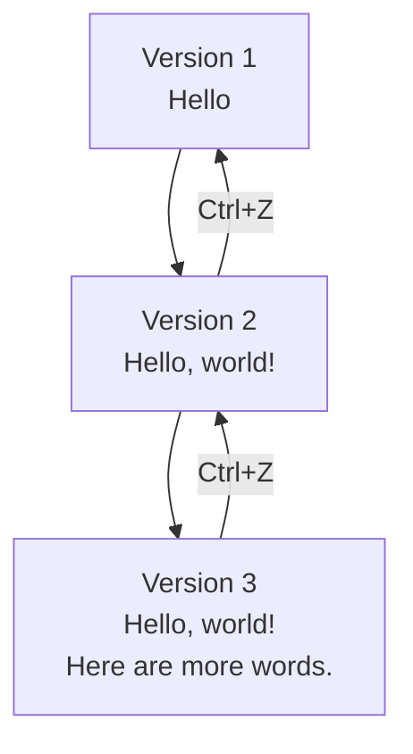
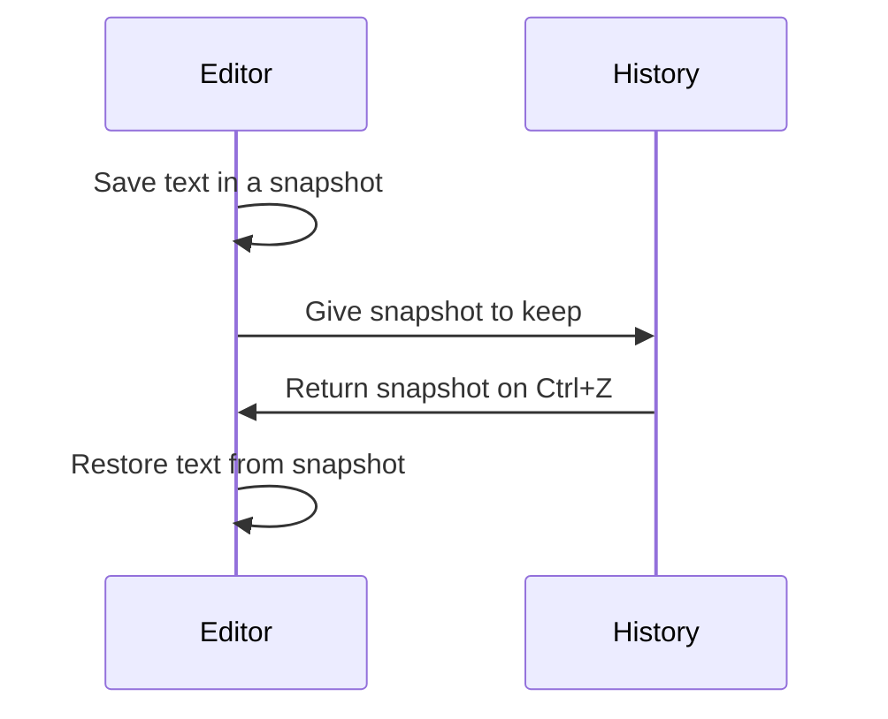

<!-- alignment: center -->

MEMENTO
===============

<!-- font_size: 2 -->
<!-- jump_to_middle -->
<!-- speaker_note: go to next slide when ready -->
**Undo/redo without breaking encapsulation**
<!-- font_size: 1 -->

<!-- end_slide -->

<!-- alignment: center -->

MEMENTO
=====================
<!-- speaker_note: Press Space to reveal the word origin. -->
<!-- pause -->

From Latin, literally *mementō*, “remember!”
<!-- speaker_note: Press Space to reveal a definition. -->
<!-- pause -->

In English (Oxford dictionary), a thing that you keep or give to somebody to remind you or them of a person or place.

<!-- speaker_note: Press Space again to reveal the image and movie description. -->
<!-- pause -->

<!--
speaker_note: |
  The Russian GoF edition calls the pattern «Хранитель». It is an established label, but «снимок состояния» describes the Memento object more clearly.
-->
<!-- pause -->


*In Christopher Nolan’s film Memento (2000), Leonard Shelby (Guy Pearce) uses photos, notes, and tattoos to investigate his wife’s murder because he cannot form new memories.*

<!--
speaker_note: |
  The film is a memory-related analogy, not the source of the pattern. Christopher Nolan wrote and directed the 2000 film, and Guy Pearce plays Leonard Shelby. GoF’s book describes the Memento pattern in 1994, before the film.
-->

<!-- end_slide -->

What does Ctrl+Z actually need?
===============================

<!-- alignment: center -->

<!--
speaker_note: |
  Press space to show blank editor
-->

<!-- pause -->
Blank file

```text
| <- cursor


```

<!--
speaker_note: |
  Press space to show version 1
-->

<!-- end_slide -->

What does Ctrl+Z actually need?
===============================

<!-- alignment: center -->

Version 1

```text
Hello|
~~~~~^


```

<!--
speaker_note: |
  Press space to show version 2
-->

<!-- end_slide -->

What does Ctrl+Z actually need?
===============================

<!-- alignment: center -->

Version 2

```text
Hello, world!|
~~~~~~~~~~~~~^


```

<!--
speaker_note: |
  Press space to show version 3
-->

<!-- end_slide -->

What does Ctrl+Z actually need?
===============================

<!-- alignment: center -->

Version 3

```text
Hello, world!
Here are more words|
~~~~~~~~~~~~~~~~~~~^


```

<!--
speaker_note: |
  Press space to show flowchart
-->

<!-- end_slide -->

What does Ctrl+Z actually need?
===============================

<!--
speaker_note: |
  Next: question
-->



<!-- pause -->

<!-- alignment: center -->

**Undo** from version 3 → version 2  
**Redo** from version 2 → version 3

The question: *Who saves the old state, and who is allowed to read it?*

<!--
speaker_note: |
  The user doesn't care which methods produced the text, they care that the previous state can be restored.

  We need a place to keep past versions. The next question is whether that place should be allowed to know the internals of the editor.
-->

<!-- end_slide -->

What does Ctrl+Z actually need?
===============================

<!-- alignment: center -->



**History keeps snapshots, the editor understands them.**

<!--
speaker_note: |
  The editor knows how its text is stored, so it creates the snapshot and knows how to restore it. History only keeps snapshots and returns one when Ctrl+Z is pressed, it does not inspect the saved text.
-->

<!-- end_slide -->
