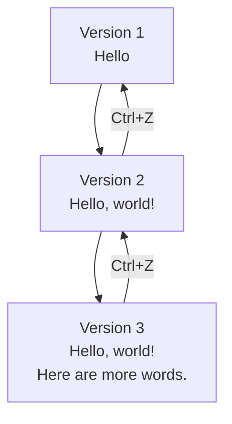
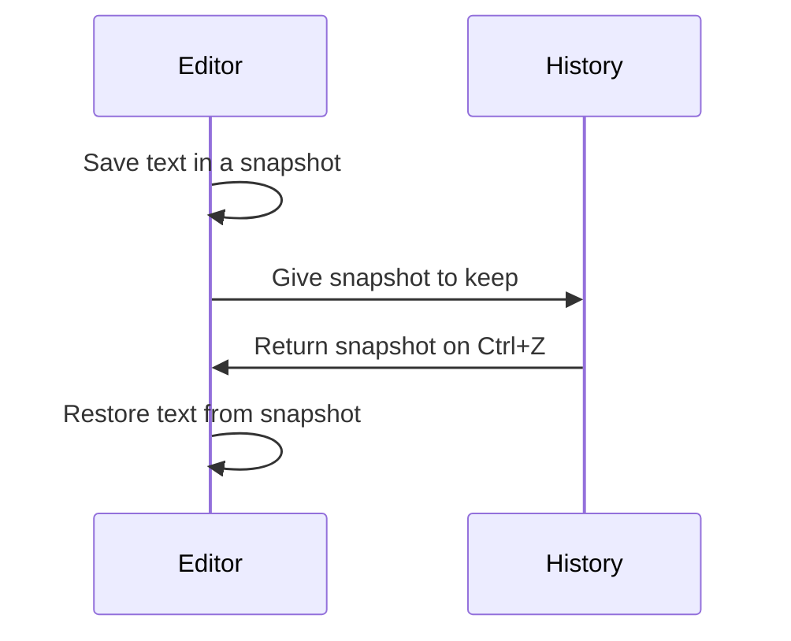

<!-- alignment: center -->

MEMENTO
===============

<!-- font_size: 2 -->
<!-- jump_to_middle -->
<!-- speaker_note: go to next slide when ready -->
**Undo/redo without breaking encapsulation**
<!-- font_size: 1 -->

<!-- end_slide -->

<!-- alignment: center -->

MEMENTO
=====================
<!-- speaker_note: Press Space to reveal the word origin. -->
<!-- pause -->

From Latin, literally *mementō*, “remember!”
<!-- speaker_note: Press Space to reveal a definition. -->
<!-- pause -->

In English (Oxford dictionary), a thing that you keep or give to somebody to remind you or them of a person or place.

<!-- speaker_note: Press Space again to reveal the image and movie description. -->
<!-- pause -->

<!--
speaker_note: |
  The Russian GoF edition calls the pattern «Хранитель». It is an established label, but «снимок состояния» describes the Memento object more clearly.
-->
<!-- pause -->


*In Christopher Nolan’s film Memento (2000), Leonard Shelby (Guy Pearce) uses photos, notes, and tattoos to investigate his wife’s murder because he cannot form new memories.*

<!--
speaker_note: |
  The film is a memory-related analogy, not the source of the pattern. Christopher Nolan wrote and directed the 2000 film, and Guy Pearce plays Leonard Shelby. GoF’s book describes the Memento pattern in 1994, before the film.
-->

<!-- end_slide -->

What does Ctrl+Z actually need?
===============================

<!-- alignment: center -->

<!--
speaker_note: |
  Press space to show blank editor
-->

<!-- pause -->
Blank file

```text
| <- cursor


```

<!--
speaker_note: |
  Press space to show version 1
-->

<!-- end_slide -->

What does Ctrl+Z actually need?
===============================

<!-- alignment: center -->

Version 1

```text
Hello|
~~~~~^


```

<!--
speaker_note: |
  Press space to show version 2
-->

<!-- end_slide -->

What does Ctrl+Z actually need?
===============================

<!-- alignment: center -->

Version 2

```text
Hello, world!|
~~~~~~~~~~~~~^


```

<!--
speaker_note: |
  Press space to show version 3
-->

<!-- end_slide -->

What does Ctrl+Z actually need?
===============================

<!-- alignment: center -->

Version 3

```text
Hello, world!
Here are more words|
~~~~~~~~~~~~~~~~~~~^


```

<!--
speaker_note: |
  Press space to show flowchart
-->

<!-- end_slide -->

What does Ctrl+Z actually need?
===============================

<!--
speaker_note: |
  Next: question
-->



<!-- pause -->

<!-- alignment: center -->

**Undo** from version 3 → version 2  
**Redo** from version 2 → version 3

The question: *Who saves the old state, and who is allowed to read it?*

<!--
speaker_note: |
  The user doesn't care which methods produced the text, they care that the previous state can be restored.

  We need a place to keep past versions. The next question is whether that place should be allowed to know the internals of the editor.
-->

<!-- end_slide -->

What does Ctrl+Z actually need?
===============================

<!-- alignment: center -->



**History keeps snapshots, the editor understands them.**

<!--
speaker_note: |
  In GoF's role names, the editor is the Originator: it creates a Memento and uses it to restore its state. The Memento is the saved state. History is the Caretaker: it keeps Mementos and returns one on Ctrl+Z without inspecting its contents.
-->

<!-- end_slide -->

PARTICIPANTS
=====================================

<!-- pause -->

# **Originator («Создатель»)**

- creates a memento containing a snapshot of its current internal state.
- uses the memento to restore its internal state

<!-- pause -->

# **Memento («Снимок»)**

- stores internal state of the Originator.
- protects against access by objects other than the originator

<!-- pause -->

# **Caretaker («Опекун»)**

- is responsible for the memento's safekeeping.
- never operates on or examines the contents of a memento

<!--
speaker_note: |
  The Russian terminology can be confusing because «Хранитель» is used as a name for the pattern, while «Снимок» describes the saved Memento object more directly. 

  Some translation difficulties here, so let's stick with original English words.
-->

<!-- end_slide -->

Memento: TextMemento
====================

```file
path: src/editor.ts
language: typescript
start_line: 4
end_line: 25
```

<!--
speaker_note: |
  The Memento interface is the narrow view. It has only a symbol marker and exposes no saved state. The unexported symbol helps TypeScript distinguish genuine Mementos from arbitrary objects. TextMemento is the concrete class and provides the wide view through its state getter. It stores the saved string privately and has no restore method or editor reference. Strings are immutable, so later edits do not change the saved value.

  The symbol is a type marker, not a privacy mechanism. The narrow interface hides state during type checking; the concrete class still exposes a public getter at runtime.
-->

<!-- end_slide -->

Originator: Editor
==================

```file
path: src/editor.ts
language: typescript
start_line: 30
end_line: 63
```

<!--
speaker_note: |
  Editor owns the current text. update changes it, while snapshot creates a TextMemento and returns it through the narrow Memento interface. restore accepts that narrow type, checks that the object is a TextMemento, and then reads state through the concrete class's wide view. The check both validates the object at runtime and narrows its type for TypeScript.

  render is terminal UI code, not part of the Memento pattern. The readline object and unfinished input are not included in the snapshot. The runnable example uses Node's built-in TypeScript type stripping, which runs the code but does not type-check it.
-->

<!-- end_slide -->

Caretaker: History
==================

```file
path: src/history.ts
language: typescript
start_line: 3
end_line: 32
```

<!--
speaker_note: |
  History holds Mementos through the narrow interface and never reads their saved state. The caller saves a snapshot before each edit. save pushes it onto the undo stack and clears redo because a new edit abandons the previous redo path.

  On undo, the caller supplies a snapshot of the current state. History keeps it for redo and returns the previous snapshot. On redo, it does the reverse. The caller passes the returned snapshot to Editor.restore. The two stacks implement our undo and redo behavior; GoF does not require a particular history data structure.
-->

<!-- end_slide -->

CONSEQUENCES
=====================
<!--
speaker_note: |
  Show the actual code and how it works.
-->

<!-- pause -->

- Preserving encapsulation boundaries.

<!--
speaker_note: |
 Memento avoids exposing information that only an originator should manage but that must be stored nevertheless outside the originator. The pattern shields other objects from potentially complex Originator internals, thereby preserving encapsulation boundaries.
-->

<!-- pause -->

- It simplifies Originator

<!--
speaker_note: |
 In other encapsulation-preserving designs, Originator keeps the versions of internal state that clients have requested. That puts all the storage management burden on Originator. Having clients manage the state they ask for simplifies Originator and keeps clients from having to notify originators when they're done.
-->

<!-- pause -->

- Using mementos might be expensive

<!--
speaker_note: |
 Mementos might incur considerable overhead if Originator must copy large amounts of information to store in the memento or if clients create and return mementos to the originator often enough. Unless encapsulating and restoring Originator state is cheap, the pattern might not be appropriate. See the discussion of incrementality in the Implementation section.
-->

<!-- pause -->

- Defining narrow and wide interfaces

<!--
speaker_note: |
  It may be difficult in some languages to ensure that only the originator can access the memento's state.
-->

<!-- pause -->

- Hidden costs in caring for mementos

<!--
speaker_note: |
  A caretaker is responsible for deleting the mementos it cares for. However, the caretaker has no idea how much state is MEMENTO 287 in the memento. Hence an otherwise lightweight caretaker might incur large storage costs when it stores mementos.
-->

<!-- end_slide -->

<!-- font_size: 4 -->
<!-- jump_to_middle -->
THE END
=====================================
